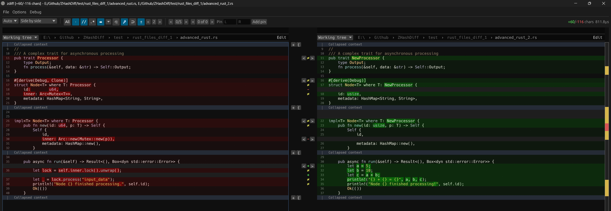
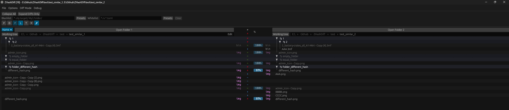

# ZDiff




Started as a tool to find and delete duplicate files with different names. It has grown into a diff suite with a file diff and a folder diff app.

Good reference & aim for this project: https://www.scootersoftware.com/

# Features
* File diff ([zdiff-gui](./crates/zdiff-gui)): token-based diff of text with scope, line, token and character phases, plus hex, image, audio and video viewers and a 3-way merge view
* Folder diff ([zdiff-folder-gui](./crates/zdiff-folder-gui)): two-folder tree diff with background compare, likeness, tolerance and filters
* Duplicate finder: size + hash grouping, pick a keeper, recycle the rest
* Git and Perforce: diff files and folders at a git revision, or a Perforce revision, changelist or shelf
* Works as the diff and merge tool for p4, P4V, git, TortoiseSVN and TortoiseGit
* Shared keybinding editor, find, style window and presets in both apps

# Crates
| Crate | Purpose | Type |
| :--- | :--- | :--- |
| [**zcommon**](./crates/zcommon) | Shared utilities and egui widgets | Library |
| [**zdiff**](./crates/zdiff) | File-level diff | Library |
| [**zdiff-gui**](./crates/zdiff-gui) | egui app for zdiff | Application |
| [**zdiff-folder**](./crates/zdiff-folder) | Folder-level diff | Library |
| [**zdiff-folder-gui**](./crates/zdiff-folder-gui) | egui app for zdiff-folder | Application |
| [**xtask**](./xtask) | `cargo xtask fetch-ffmpeg` ([ffmpeg](./ffmpeg/README.md)) | Tool |

# Build
```
cargo build --workspace
cargo run -p zdiff-gui
cargo run -p zdiff-folder-gui
```
Build `zdiff-gui` before `zdiff-folder-gui`: zdiff-folder-gui's build script bakes in the path to `zdiff-gui.exe` as the default external diff tool. The audio and video viewers need ffmpeg (`cargo xtask fetch-ffmpeg`).

# Todo
* Option to stop the console log window from opening with the app (zdiff-gui opens one in every build, zdiff-folder-gui in debug builds)
* Diff mode for `.pdb` files, with options such as stripped PDBs
* ~2% CPU while moving the mouse over either app; the only mouse interactions should be drag and drop and hover
* Patch view mode in the file diff, so the diff can be read as a patch without exporting it first
* Folder view resets every so often on large folders (not reproduced yet)
* Still performance issue when doing seemingly nothing. Specific case was "string diff view" and moving around window. This should not be expensive at all.
* Implement frame rate performance counter, in fps always visible, but also include option that shows a breakdown of the frame time.
* Found a bug where changing the "diff only" "line amount", when getting to around 8 in my specific case (do not have it any longer), the application just sets back the "diff only" "line amount" to 0.
* "working tree" text should be renamed to "Source control" or something similar.
* The "working tree" drop down shows "no git ..." and a lot of text. Improve this.
* New feature, when showing a "progress bar" for likeness, should be able to hover to show a visualization of the likeness, idea is to be able to easily see what part of the file is changed for example. Another example is .png diff where it should show an image showing the likeness computation per texel (for example if a kernel is used to compute per pixel, we show the kernel result)
* I want the Pane ui to be the same between ZDiff-Gui and ZDiff-Folder-Gui.
* I want to refactor the non-unique specific diff & ui code to the zcommon & zcommon-ui crates.
* New feature for ZDiff-Folder-Gui to visualize in a spatial representation the diff. This should be a novel and easy to use UX.
* In ZDiff-Gui there should be a option button to ignore any text-file specific markers, such as crlf. Also another button for ignoring other etc things such as end of file, begining of line and such.
* In ZDiff-Gui on large number of lines files the line number gets shorten, for example I can see it showing "1497..." which is not ok. Need to always see the full line number
* Implement video/image diff calculations that not only check texel against texel but takes in to consideration the nearby texels. This should also allow for diffing differently sized images.
* ZDiff UI should somewhere in a UX friendly location show the amount of "likeness". Also be able to change the likeness metric with a drop down, this should be tied to the current diff mode.
* Switching between Frames/audio tabs for a video diff has to recompute the audio view. This should only be discarded if the diff is invalidated.
* Make the Diff views a more final production UI/UX across ZDiff-Gui and ZDiff-Folder-Gui.
* I want the < X/Y > slider ui to be slide/draggable to select a value.
* Add different UI/UX options for customizing the diff mode colors. For example I want a option to select a color gradient for visualizing the "Mean pixel difference" bars instead at just looking at pink.
* If possible, speed up the seeking speed for selecting a different frame in the frame view. Currently it takes ~0.5seconds. If possible I want to be able to live drag the cursor as a slider and the frame instantly shows the frame.
* Rename "Blink" mode to "A/B"
* Double clicking the diff modes such as "Overlay" should reset the diff mode sliders to the defaults for that view mode.
* In the audio/video view I can "zoom out further out than the 'fit'". The zoom out should be clamped at the "fit" zoom level.
* I want some kind of "action" undo behavior. Undo should be bound to "ctrl+z" and also "back mouse button" by default. And redo should also exist with their corrospending default keybindings.
* If I click a "source control" option for the currently opened file, I need to be able to go back to the most previously selected item.
* Should by default not open black terminal console window when starting the diff tool. Should have a commandline argument -log that opens it (both Gui crates)
* More "code languages" should be supported. Also make it more broader, make it "highlight syntax" or similar (think about a better name, if you have a better one please use that one)
* I want a easy but powerful caching code system that caches the results for different diff options in both applications.

---

# Notes
Hobby project for personal use. Windows is the primary platform.
