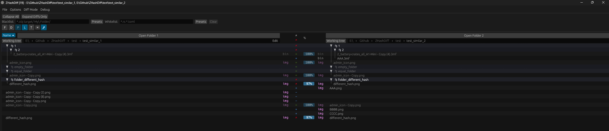

# ZDiffFolder-GUI



GUI for zdiff-folder crate

```
zdiff-folder-gui [<dir1> [<dir2>]] [-log]
```

No console window opens. `-log` writes the log to the terminal zdiff-folder-gui was started from, or to a new console window when there is none.

A crash (panic) appends its message, source location and backtrace to `crash.log` next to the saved state (`%APPDATA%\ZDiffFolder\data\crash.log` on Windows) before the process exits.

# Features
* Two-folder tree diff
    - Background scan and compare, rows show Pending until compared; counts and timings in the status line
    - Compare and likeness results survive rescans in memory-bounded caches (256 MiB each, least recently used pairs dropped first); a likeness is only reused when measured with the same file kinds and pixel tolerance
    - Rebuilt rows (compare finished, sort, filters) keep the top row of the view in place, or its nearest shown folder
    - Compared rows are cached in memory per path filter and tolerance (last 6), so sort, diff only, flat and switching a filter or tolerance back skip the rebuild (about 130 ms down to 20 ms for 52,000 rows); a rescan or new compare results drop them
    - Breadcrumb path bars, right-click menu on rows (set as root, set as Left/Right folder, open in Explorer, copy path)
    - Tree guide lines, folder tint, dimmed equal rows
    - File type tag column per side (`img`, `bin`, `BP` for Blueprint `.uasset`, ...)
    - Sort by Name or State, cursor with keyboard navigation, next/previous differing file
    - Find with highlighted names
    - Blacklist and whitelist filters with presets
* Map view: Map in the pane toolbar's Tree | Map | Duplicates switch (Ctrl+M toggles Tree and Map)
    - Squarified treemap of the rows the tree shows (filters and find apply): a box per file sized by its larger side, colored by its diff state, equal files muted
    - With L (likeness) on, a box present on both sides, files and folders alike, is colored by how alike its sides are, in the likeness bar's colors (Style: Difference colors), with a legend in the breadcrumb row; boxes on one side only or not compared or measured yet keep their state color
    - A thin bar on a differing file shows the smaller side's share of the larger one
    - Hover shows the path, both sizes, the state and the likeness; click selects (the tree follows), double-click opens the diff
    - Click a folder to zoom in; the breadcrumb, Backspace or the mouse back button zoom out
    - Scroll (or Ctrl+scroll, pinch) zooms about the pointer, so boxes merged into `+N` and closed folders open up into named boxes; drag pans a zoomed map; middle-click, the Fit button, Backspace or the mouse back button show the whole folder again, and every folder change starts fitted
* Pane toolbar: Tree | Map | Duplicates, Collapse All (Expand All once anything is folded) / Expand Diffs Only and the option toggles in one row, the filters below; the same toolbar look and text-labelled toggles as zdiff-gui. In a narrow window its groups wrap onto more rows instead of clipping
* Tree background follows the light or dark style (Style window: Table background)
    - F: flat list by depth
    - D: diff only
    - P: show parent folders (with diff only)
    - L: likeness bar, how alike each pair is (lines, pixels or bytes); hovering a file's bar shows where it differs, computed on the first hover: text a strip of changed lines per side, binary a strip of unequal bytes, images a thumbnail of the per-pixel difference
    - T: tolerance, differing files that pass the size, modification time or likeness criteria count as Similar
* Options > Link Horizontal Scrolling (on by default): both folder sides scroll sideways together; off scrolls them independently
* Sides named Left and Right (menus, shortcuts, status line); with no folder open the pane still shows both empty sides with their headers and path bars, and the welcome text with Open Left / Open Right over them (or a spinner while the first scan runs); a folder dropped on a side, header included, becomes that side's root; a root that can't be opened (a dropped file, a missing folder, a bad command-line folder) is named in the status line
* Roots at a git revision or a Perforce depot folder, changelist or shelf, picked from a "Source control" dropdown next to each path bar; its "Back to ..." entry returns to the side's previous revision of the same folder
* External diff tools
    - Tools window with presets (zdiff-gui, TortoiseMerge, WinMerge, Beyond Compare, p4merge, VS Code, ...), argument templates, rules and a Test button
    - Executables are found next to the app, at the build path or on PATH
    - Rows a tool can't diff are marked
* Duplicates view: Duplicates in the same switch (Ctrl+D toggles it with the folder diff) finds duplicate files in the left folder; its toolbar starts with the switch too, and Tree or Map goes back to the folder diff in that view
    - Size collisions hashed in the background, with progress and Cancel
    - Duplicate groups shown inline in the tree; Duplicates only, Flat, Show parent folders and Hash column toggles
    - Keep this, next/previous group, then Resolve recycles the non-keepers
* Undo (Ctrl+Z, mouse back) and redo (Ctrl+Y, Ctrl+Shift+Z, mouse forward) of root changes on either side, revision picks included, and swap sides, up to 100 steps; filters, sort and folding are not undone. Over a zoomed-in map the back button zooms out instead
* Customizable keybindings (Ctrl+O), shared with zdiff-gui for the common actions (undo and redo included); the middle, back and forward mouse buttons can be bound too, style window
* Difference colors in the style window (Heat by default, Viridis, Inferno, Grayscale, Solid), shared with zdiff-gui: they color the likeness bars and their hover maps
* Frame rate counter at the right end of the menu bar, `N fps (M)`: N is 1 / average CPU time per frame over the last 120 frames (vsync wait excluded), so it shows what a frame costs; M is the frames actually started in the last second, which follows input and the vsync cap; marked idle once frames stop, and M is hidden then; clicking it (or Options > Frame Time Breakdown) opens the Frame Time window: Total CPU per frame (average, max, the fps and the input-driven repaint rate) on top, then the breakdown over the last 120 frames: the app's update sections, each split into indented sub-sections plus a "(rest of section)" row, and "egui + OpenGL (outside app code)" split into egui's pass start, pass end, and tessellation plus OpenGL paint. A V-sync checkbox at the bottom is saved per app and applies on the next start, as eframe sets the swap interval only when it creates the window

## Configuration

zdiff-folder-gui reads a `.env` file only from the folder of its executable (`target/<profile>/` for `cargo run`). The working directory and its parents are not searched. Real environment variables win over `.env` values. The log window shows which file was loaded, or that none was found.

# Todo
* Maybe fixed?? ____ Some PCs egui becomes white after first launch ____ 

## Duplicate file diff:
* Allow restoring of resolved files (maybe mark file names as red?)
