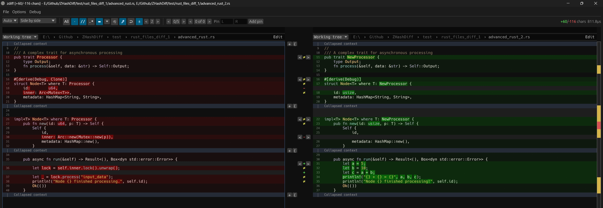
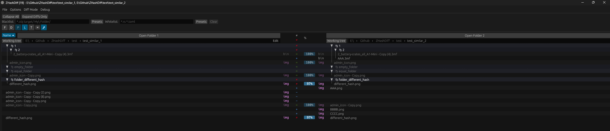

# ZDiff-GUI



GUI for the zdiff and zdiff-folder crates: file diff, folder diff and 3-way merge in one window

# Features
* Myers diffing (Options > Myers Algo)
    - Linear version (default)
    - Linear MT version
    - Trace version
* Keybindings
    - Customizable (Ctrl+O), every toolbar toggle has an action; the middle, back and forward mouse buttons can be bound too
    - P4 integrated commands and quick diffs (F1-F4)
* Undo (Ctrl+Z, mouse back) and redo (Ctrl+Y, Ctrl+Shift+Z, mouse forward) of the latest action: a side's file or revision (path bar, Source control dropdown, browser, drop, quick diff, clear paths), swap sides and hunk reverts, in one history of up to 100 steps. Reverts made on the shown pair step first; going back to another pair drops their history (the files keep the reverted contents). Option toggles, viewer modes and scrolling are not undone. In the merge view the same keys undo and redo merge picks; a focused text field keeps its own Ctrl+Z
* Text diff view
    - Side by side, Unified, or a single side at full width with its changed lines tinted
    - Patch: the diff as the unified patch Export Diff writes (3 context lines, current ignore options), with a Copy patch button; find, goto line and hunk revert work only in the row views
    - Next/previous conflict (Ctrl+1/2, Alt+Up/Down), goto line (Ctrl+G)
    - Jumps (goto line, next/previous conflict, find, hex goto, merge chunks) put the target in the middle of the view; a block taller than the view starts at the top. Options > Center Jumps, on by default; off puts the target at the top
    - Find (Ctrl+F) with whole word and regex
    - Toolbar `< X >` steppers (context rows, conflict, find match): drag the value sideways to pick one, double-click it to reset
    - Line pins: align chosen line pairs
    - Overview ruler beside the scrollbar; click or drag to scroll there
    - Collapsed context blocks expand, up to the enclosing scope's opening line
    - Scope bar over the top of each side's text, side-by-side view only: the first lines of the scopes the top visible line is in, up to the innermost 5 (Options > Scope Bar as Breadcrumb shows them as one row of names instead). Scopes come from `{}` when a file's braces balance and span lines, else from indentation (Python, YAML). Clicking one scrolls to it; in diff only, a first line hidden in a collapsed block is revealed from there down. Options > Scope Header per Collapsed Block also names, on each collapsed row, the scopes its next change is in (`fn outer  >  fn inner`), clickable the same way
    - Word wrap with aligned rows, horizontal scrolling with optional linked sides (Options > Link Horizontal Scrolling, Alt+L; on by default, not part of the toolbar's All)
    - Syntax highlighting for ~190 languages (bat's syntax set), auto-detected per pane by file name, extension or first line, or picked from a filterable list (Options > Syntax Highlighting); secondary syntaxes such as HTML (Rails) or Git Config are left out until the filter has text, and unticking "Show variants when filtering" (persisted) keeps them out of filter results too
    - Diff status with -/+ counts and compute time per stage
    - Likeness bar at the right end of the toolbar (the same bar as the folder diff's), followed by its metric: a dropdown where the viewer offers a choice (Text: Lines or Tokens; Image: the pixel metric), otherwise the measure's name as plain text, explained on hover (Hex: Bytes; Audio: RMS; Video: Frames). Hover the bar for the formula and where the pair differs (a strip of changed lines per side, unequal bytes or the sample difference's peak, or for images a thumbnail of the difference map under the current metric). Formulas: Text: matching lines, or tokens with the Token phase on, both honoring the ignore options (persisted); Hex: equal bytes at the same offset; Image: pixels within the tolerance under the image metric (the same setting as the image toolbar's Metric); Audio: 1 - RMS(left - right) / (RMS(left) + RMS(right)); Video: 1 - the timeline's mean frame difference / 255
    - Revert a hunk on disk, with undo/redo (refused after an external change); read-only Perforce files are offered a `p4 edit`
    - Occurrence highlight: selecting text in a row highlights its other occurrences in the visible rows, on both sides
    - Diff options (toolbar; icon or short text toggles with tooltips, the same toolbar look as the folder diff)
        + Ignore whitespace (WS), comments (//), and regex patterns (.*, with presets); ignored regex matches are dimmed
        + Ignore line endings (EOL, Alt+E): CRLF, LF and CR compare equal. EOL and BOM are drawn as bordered tags: they name markers, not text
        + Ignore file markers (BOM, Alt+M): a UTF-8 BOM at the start and the presence of a final line break
        + Highlight rows that differ (HL): switches the diff marks on/off; its dropdown picks changed scopes, lines, tokens and/or characters
        + Diff phases (Options): Scope, Line and Token (both default), Character. Each runs only where the coarser one found a change; with none on, the lines just sit side by side
        + Inline ghost tokens (👻)
        + Diff only (±), with a context row count
        + Word wrap (↩)
        + Toggle all options (All, Alt+A)
    - In-memory results cache: each diff stage keeps its last 16 results (up to 1.5 GB in all; a 4.6 MB pair keeps 12 option states, pairs up to about 3 MB all 16) and each side its last 6 file loads (32 MB), keyed by the file contents and the options that stage uses, so toggling an option back or returning to an earlier pair shows at once, in one frame. The pane remembers its row measurements, unified rows and patches for those results too. While an option change of the same files computes, the pane keeps showing the last diff with "Updating..." in the toolbar; a new file shows "Comparing files...". The worker counts each row's chars, so a first visit sizes rows without building their text (a few ms on a 4.6 MB pair). What still runs on the UI thread on a first visit: laying out the rows that wrap with word wrap on (about 10 ms per 25k lines, 35 ms at 4.6 MB) and building the Unified and single-side views (about 6 ms per 25k lines, 40 ms at 4.6 MB). The Patch view builds on a worker thread and shows the last patch until it is done. Unchanged local files (same size and modification time) and fixed revisions (`#rev`, `@change`, full commit SHA) are not read again; head, branch and index sides always are. Refresh and Recompute Diff compute from scratch
* Sides, named Left and Right in menus and shortcuts
    - Breadcrumb path bar per side under a breadcrumb root bar, and a folder browser over that side to pick another file
    - The path bars stay shown with no files loaded ("No file", "No root folder"), so a path can be typed before any diff
    - An empty pane shows both sides under their path bars, each outlined as a drop target, with the welcome and Open Left / Open Right over them. It takes a dropped file anywhere in either side's column, path bars included, split at the divider, for the side whose header that column shows (also with the sides swapped); files that fail to load show their errors there instead
    - The toolbar wraps onto more rows in a narrow window instead of clipping; the diff status moves to its own row when it doesn't fit
    - Local paths, Perforce depot paths, changelists and shelves, git revisions, picked from a "Source control" dropdown per side; its "Back to ..." entry returns to the side's previous revision of the same file, with the header label it had (a quick diff's, for one), as undo does
    - Diff a depot file against its local file (Ctrl+L), a shelved file against its base revision (Ctrl+B)
* Viewers, picked from the file kind (override per diff); mismatched types show each side in its own viewer
    - Hex: Bytes or Strings mode (no hunk revert in Strings), overview strip, next/previous difference, goto offset, value inspector (ints, floats, string, endian toggle)
    - Image: side by side, A/B, difference, heatmap, histogram, swipe and overlay; channel filter, tolerance, Nearest/Linear sampling, linked zoom and pan
    - Image metric (Exact, Neighborhood 3x3/5x5/7x7 listed as 3x3, 5x5 and 7x7, SSIM; hover an option for what it measures, likewise the channel, alignment and sampling options) for the difference, heatmap and changed count, with the tolerance on its 0 to 255 scale; hover the count for the mean difference (mean SSIM). Alignment of differently sized images: top left, center or scale to fit, for drawing and comparing. Both are saved; the video difference timeline uses the same metric, but always scales both videos to one small size (from the left video's aspect) whatever the Alignment, so its bars and the video likeness can read alike where the Frames view with Top left shows a size mismatch as changed. Every metric computed for an image, per channel and alignment, is kept until the files (or the video frame) change, up to 256 MB, and one left while it computes keeps computing, so switching back to one shows its difference, heatmap, count and likeness at once; while a metric computes, the count tooltip and the likeness thumbnail keep showing the previous one. The timeline likewise keeps each metric's run for the video pair, finished or still computing in the background; Cancel stops them all
    - Audio: waveform lanes, overlay, spectrograms with their dB difference, sample difference lanes, metadata table with loudness
    - Video: frame compare with timestamp matching, scrubber and frame steps, a difference timeline, Audio and Metadata tabs (the audio decodes when the Audio tab first opens and is kept until the pair changes)
    - Video seeking: dragging the scrubber or the timeline shows low-res previews (about 320 px wide, decoded for the whole video in the background) at once, and the exact frames land when the drag pauses or ends. The frames around the cursor are decoded ahead into a cache (256 MB per side), so frame steps and going back and forth show at once.
    - Zooming out stops at fit: the whole image (or 1:1 for an image smaller than the view), the whole audio length
    - Double-clicking an image or audio mode button resets that mode's own settings (A/B interval, swipe divider, overlay opacity, spectrogram window and ranges)
    - Audio and video need ffmpeg: `cargo xtask fetch-ffmpeg` (see [ffmpeg/README.md](../../ffmpeg/README.md))
    - PDB (MSF 7.00): diffed as a sorted text dump: header (version, machine, stripped, optionally GUID/age/timestamp), modules, public symbols, global symbols (procedures with signatures and sizes, data, typedefs, constants; no locals), and one line per class/struct/union/enum with its fields. The toolbar's PDB menu (persisted) has Public only (as stripped), so a full PDB compares clean against its stripped copy, Ignore addresses/RVAs and Ignore GUID/age/timestamp (on by default); a change reloads the dumps. Capped at 1,000,000 lines with a truncation marker that holds the count and a hash of the lines left out, so two dumps that differ only there still show a changed line. A PDB that doesn't parse is shown in Hex; Hex and Strings on a PDB show its real bytes. Dumps can't be reverted into or merged. The folder diff still compares PDBs by bytes, so a rebuild always differs there
* 3-way merge view: picks, chunk editing, undo/redo, conflict navigation, save (Ctrl+S)
* Style window: text, syntax, hex and image colors, presets, and the look of empty and collapsed rows
* Difference colors (Style window, or the Colors dropdown beside the video difference timeline): Heat (the default, green to yellow to red), Viridis, Inferno, Grayscale, Solid or Rainbow (blue to red), one choice for both themes, shared with the folder diff. It colors the timeline bars by height, the image heatmap and its legend, the likeness bar (low end for alike, high end for unlike) and its hover maps
* Frame rate counter at the right end of the menu bar, `N fps (M)`: N is 1 / average CPU time per frame over the last 120 frames (vsync wait excluded), so it shows what a frame costs; M is the frames actually started in the last second, which follows input and the vsync cap; marked idle once frames stop, and M is hidden then; clicking it (or Options > Frame Time Breakdown) opens the Frame Time window: Total CPU per frame (average, max, the fps and the input-driven repaint rate) on top, then the breakdown over the last 120 frames: the app's update sections, each split into indented sub-sections plus a "(rest of section)" row, and "egui + OpenGL (outside app code)" split into egui's pass start, pass end, and tessellation plus OpenGL paint. A V-sync checkbox at the bottom is saved per app and applies on the next start, as eframe sets the swap interval only when it creates the window

## Folder diff



Two folders, or a folder and an empty side, show the folder diff. It is chosen from the two sides like the other viewers, so there is no mode to switch: put a folder on a side by typing it into the path bar, dropping it, File > Open Left / Right Folder, or `zdiff-gui LEFT [RIGHT]`. A folder against a file stays a file diff, and the folder side says so in its path bar. `--folder` only marks depot paths as folders (a depot path can't be told from a file without asking p4); local folders need no flag. The folders are not reopened on the next start.

* Shared with the file viewers: the path bars, the "Source control" dropdown per side (a git revision, or a Perforce depot folder, changelist or shelf, with its "Back to ..." entry), Swap Sides, Clear Paths, Undo / Redo (Back / Forward, mouse buttons included) over one history of files and folders, Options > Link Horizontal Scrolling, the Style window and its Difference colors, the frame rate counter, and the one Keyboard Shortcuts window (Ctrl+O), which lists the folder diff's own actions in a "Folder diff" section. Esc closes nothing
* A row opens in the same window with the bundled tool (zdiff-gui), for disk, git and depot rows; Back returns to the folder diff with its views, folding, cursor, scroll and filters as they were. A tool set to an explicit exe path, or any other tool, opens a separate process. While a file pair shows, scans and compares keep running and their results are applied on return
* Two-folder tree diff
    - Background scan and compare, rows show Pending until compared; counts and timings in the status line under the tree
    - A side that can't be scanned (a missing folder, a cancelled scan) shows its error on that side; Refresh or a new path scans again
    - Compare and likeness results survive rescans in memory-bounded caches (256 MiB each, least recently used pairs dropped first); a likeness is only reused when measured with the same file kinds and pixel tolerance
    - Rebuilt rows (compare finished, sort, filters) keep the top row of the view in place, or its nearest shown folder
    - Compared rows are cached in memory per path filter and tolerance (last 6), so sort, diff only, flat and switching a filter or tolerance back skip the rebuild (about 130 ms down to 20 ms for 52,000 rows); a rescan or new compare results drop them
    - Right-click menu on rows (set as root, set as Left/Right folder, open in Explorer, copy path)
    - Tree guide lines, folder tint, dimmed equal rows; the tree background follows the light or dark style (Style window: Table background)
    - File type tag column per side (`img`, `bin`, `BP` for Blueprint `.uasset`, ...)
    - Sort by Name or State, cursor with keyboard navigation, next/previous differing file
    - Find with highlighted names
    - Blacklist and whitelist filters with presets
    - PDBs are compared by bytes here, so a rebuild always differs; open the row for the PDB viewer
* Toolbar, in the file toolbar's place: Tree | Map | Duplicates, Collapse All (Expand All once anything is folded) / Expand Diffs Only and the option toggles in one row, the filters below. In a narrow window its groups wrap onto more rows instead of clipping
    - F: flat list by depth
    - D: diff only
    - P: show parent folders (with diff only)
    - L: likeness bar, how alike each pair is (lines, pixels or bytes); hovering a file's bar shows where it differs, computed on the first hover: text a strip of changed lines per side, binary a strip of unequal bytes, images a thumbnail of the per-pixel difference
    - T: tolerance, differing files that pass the size, modification time or likeness criteria count as Similar
* Map view (Ctrl+M toggles Tree and Map)
    - Squarified treemap of the rows the tree shows (filters and find apply): a box per file sized by its larger side, colored by its diff state, equal files muted
    - With L (likeness) on, a box present on both sides, files and folders alike, is colored by how alike its sides are, in the likeness bar's colors (Style: Difference colors), with a legend in the breadcrumb row; boxes on one side only or not compared or measured yet keep their state color
    - A thin bar on a differing file shows the smaller side's share of the larger one
    - Hover shows the path, both sizes, the state and the likeness, and for a differing file on disk where the pair differs (the likeness tooltip's map: changed lines per side, changed bytes or the image difference; Similar pairs once compared); click selects (the tree follows), double-click opens the diff
    - Click a folder to zoom in; the breadcrumb, Backspace or the mouse back button zoom out (over a zoomed-in map the back button zooms out instead of going back)
    - Scroll (or Ctrl+scroll, pinch) zooms about the pointer, so boxes merged into `+N` and closed folders open up into named boxes; drag pans a zoomed map; middle-click, the Fit button, Backspace or the mouse back button show the whole folder again, and every folder change starts fitted
* Duplicates view (Ctrl+D toggles it with the folder diff): finds duplicate files in the left folder
    - Size collisions hashed in the background, with progress and Cancel
    - Duplicate groups shown inline in the tree; Duplicates only, Flat, Show parent folders and Hash column toggles
    - Keep this, next/previous group, then Resolve recycles the non-keepers
* External diff tools (Options > External Diff Tools, on a folder pair)
    - Tools window with presets (zdiff-gui, TortoiseMerge, WinMerge, Beyond Compare, p4merge, VS Code, ...), argument templates, rules and a Test button
    - Executables are found next to the app, at the build path or on PATH
    - Rows a tool can't diff are marked

## Occurrence highlighting
Selecting text within one row (drag, double-click a word, triple-click the line) highlights every other occurrence of that exact text in the visible rows on both sides, in purple. Matching is case-sensitive. Selections shorter than 2 characters, whitespace-only selections and selections spanning rows highlight nothing. The highlight clears with the selection (Escape, or a click elsewhere).

egui keeps its label selection private, so the pane mirrors it for one row at a time through egui's own cursor logic (`ui_egui/occurrence.rs`). Changing the selection with Shift+arrow keys isn't followed. The highlight follows the selection one frame later.

Budget: 1 ms per frame for the search, else the trigger would have become double-click only. Measured with the release build (`cargo test --release`, the `[profile.release]` settings) on `generated/scattered_20k` (the zdiff bench fixture, 20,437 rows), searching both sides of every window of 60, 100 and 200 visible rows across the whole file, with the needles `value`, `e_`, ` =`, `va` and `compute_index(`:

| visible rows | median | worst window |
|---|---|---|
| 60 | 6-8 µs | 35 µs |
| 100 | 8-12 µs | 25 µs |
| 200 | 17-24 µs | 44 µs |

**Decision: live selection.** The worst window is under 5% of the budget.

A degenerate row such as 2000 times `a`, searched for `aa`, has a match at every character. Each row therefore highlights at most 128 matches (`MAX_OCCURRENCES_PER_ROW`). With the cap, 100 such rows cost 0.46 ms median and 0.64 ms worst; 200 rows cost 0.85 ms median and 1.1 ms worst. Without it, 100 rows cost 9 ms. Highlights past the cap in a row aren't drawn.

## Use as a diff and merge tool
zdiff-gui takes p4merge-style, git-style, GNU-style and Tortoise-style arguments (`zdiff-gui --help` lists them). Each launch opens its own window, and the process exits when you close it. The examples use `C:\Tools\zdiff-gui.exe`. Replace it with your path (for example `target\release\zdiff-gui.exe`).

No console window opens. Add `-log` anywhere in the arguments to write the log to the terminal zdiff-gui was started from, or to a new console window when there is none (from cmd or PowerShell the prompt returns right away and the log interleaves with it).

A crash (panic) appends its message, source location and backtrace to `crash.log` next to the saved state (`%APPDATA%\ZDiff\data\crash.log` on Windows) before the process exits.

A merge launch opens the merge view with the left file as theirs and the right file as yours. The process exits 0 only when the output was saved with no unresolved conflicts and not changed since; otherwise 1, including when the launch arguments are invalid. zdiff-gui is a GUI program, so cmd.exe and batch files don't wait for it or set `%ERRORLEVEL%`: a wrapper that reads the exit code starts it with `start "" /wait C:\Tools\zdiff-gui.exe ...`. p4, P4V, git and Tortoise wait for it.

### p4
```
p4 set P4DIFF=C:\Tools\zdiff-gui.exe
p4 set P4MERGE=C:\Tools\zdiff-gui.exe
```
`p4 diff` passes two files (a diff). `p4 resolve` (`m`) passes `base theirs yours merged`. zdiff-gui reads four files as a merge.

### P4V
Edit > Preferences.
- Diff: Other application. Location `C:\Tools\zdiff-gui.exe`, Arguments:
  ```
  %1 %2
  ```
- Merge: Other application. Location `C:\Tools\zdiff-gui.exe`, Arguments:
  ```
  -nb Base -nl Theirs -nr Yours -nm Result %b %1 %2 %r
  ```
  P4V has no placeholders for file names, so the labels are fixed role names.

### git
In `~/.gitconfig` (inside the quotes, use forward slashes in the path):
```
[diff]
    tool = zdiff
[difftool "zdiff"]
    cmd = \"C:/Tools/zdiff-gui.exe\" \"$LOCAL\" \"$REMOTE\"
[merge]
    tool = zdiff
[mergetool "zdiff"]
    cmd = \"C:/Tools/zdiff-gui.exe\" \"$BASE\" \"$LOCAL\" \"$REMOTE\" \"$MERGED\"
    trustExitCode = true
```
`git difftool -d` passes two folders, which open in the folder diff (see [Folder diff](#folder-diff)).

### TortoiseSVN / TortoiseGit
Settings > External Programs (TortoiseSVN) or Settings > Diff Viewer / Merge Tool (TortoiseGit), choose External.
- Diff Viewer:
  ```
  C:\Tools\zdiff-gui.exe /base:%base /mine:%mine /basename:%bname /minename:%yname
  ```
  Base is shown on the left, mine on the right.
- Merge Tool:
  ```
  C:\Tools\zdiff-gui.exe /base:%base /theirs:%theirs /mine:%mine /merged:%merged /basename:%bname /theirsname:%tname /minename:%yname /mergedname:%mname
  ```
  Theirs is shown on the left, mine on the right.

## Configuration

zdiff-gui reads a `.env` file only from the folder of its executable (`target/<profile>/` for `cargo run`). The working directory and its parents are not searched. Real environment variables win over `.env` values. The log (`-log`) shows which file was loaded, or that none was found.

## Known bugs
* lost_focus not called correctly on paths when holding down mouse: https://github.com/emilk/egui/issues/2142

## Todo
* Batch DiffRow performance optimzation
* user defined comparison per file format
* Maybe fixed?? ____ Some PCs egui becomes white after first launch ____

### Duplicate file diff
* Allow restoring of resolved files (maybe mark file names as red?)
