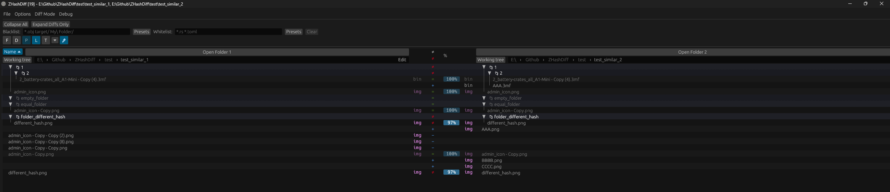

# ZHashDiff-GUI



GUI for zhashdiff crate

```
zhashdiff-gui [<dir1> [<dir2>]]
```

# Features
* Two-folder tree diff
    - Background scan and compare, rows show Pending until compared; counts and timings in the status line
    - Breadcrumb path bars, right-click menu on rows (set as root, set as Folder 1/2, open in Explorer, copy path)
    - Tree guide lines, folder tint, dimmed equal rows
    - File type tag column per side (`img`, `bin`, `BP` for Blueprint `.uasset`, ...)
    - Sort by Name or State, cursor with keyboard navigation, next/previous differing file
    - Find with highlighted names
    - Blacklist and whitelist filters with presets
* Options bar
    - F: flat list by depth
    - D: diff only
    - P: show parent folders (with diff only)
    - L: likeness bar, how alike each pair is (lines, pixels or bytes)
    - T: tolerance, differing files that pass the size, modification time or likeness criteria count as Similar
    - Link horizontal scroll of both sides
* Roots at a git revision or a Perforce depot folder, changelist or shelf, picked from a revision dropdown next to each path bar
* External diff tools
    - Tools window with presets (zdiff-gui, TortoiseMerge, WinMerge, Beyond Compare, p4merge, VS Code, ...), argument templates, rules and a Test button
    - Executables are found next to the app, at the build path or on PATH
    - Rows a tool can't diff are marked
* Duplicates tab
    - Size collisions hashed in the background, with progress and Cancel
    - Duplicate groups shown inline in the tree; Duplicates only, Flat, Show parent folders and Hash column toggles
    - Keep this, next/previous group, then Resolve recycles the non-keepers
* Customizable keybindings (Ctrl+O), style window

# Todo
* Maybe fixed?? ____ Some PCs egui becomes white after first launch ____ 

## Duplicate file diff:
* Allow restoring of resolved files (maybe mark file names as red?)
